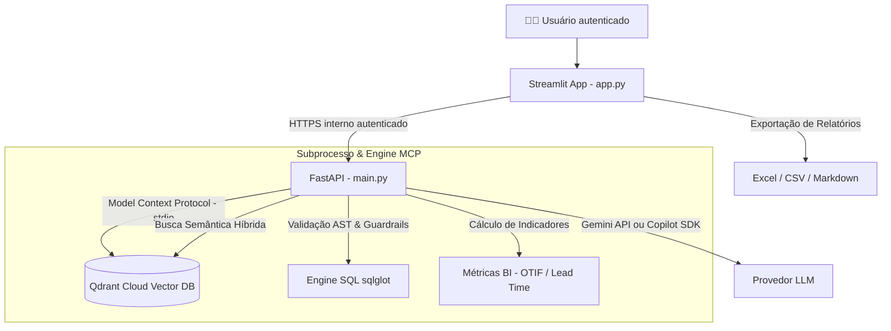

# 🤖 Vetra — Agente Consultivo de Dados & GenAI (Enterprise Platform)

A **Vetra** é uma plataforma consultiva de inteligência de dados desenvolvida para atuar como assistente de Engenharia de Dados e BI. Ela combina arquitetura desacoplada via **Model Context Protocol (MCP)**, busca semântica **RAG no Qdrant Cloud**, validação de segurança **SQL AST (Schema-Aware)** e os provedores de LLM Google Gemini e GitHub Copilot.

---

## 🏛️ Arquitetura do Sistema

---

📝 Changelog

[Próxima versão]

* O ciclo Gemini preserva `thought_signature` nas chamadas de ferramenta; erros de assinatura inválida não disparam tentativas redundantes em outros modelos.
* Anexos de conversa são selecionados e enviados junto com o prompt pelo campo de chat, sem iniciar consulta apenas por selecionar um arquivo. O preparo de documentos ocorre somente após o envio.
* A interface usa tema escuro próprio, hierarquia visual mais leve, controles secundários recolhidos, ícones Material e atualizações de streaming agrupadas para reduzir renderizações.
* `GEMINI_MODELS` permite configurar a ordem de modelos com cota disponível. Erros 429 de cota continuam visíveis com o detalhe retornado pelo provedor; ajuste faturamento/cotas no projeto Google quando todos os modelos configurados estiverem esgotados.
* Backend mantém uma sessão MCP persistente por worker FastAPI; o processo e a conexão deixam de ser recriados a cada mensagem.
* Respostas Gemini usam streaming assíncrono real. O SSE publica tokens, andamento, ferramentas em execução e conclusão; a UI atualiza a resposta progressivamente.
* O ciclo agente limita concorrência, tempo total, etapas, tamanho de resultados e histórico; chamadas de ferramentas independentes podem rodar em paralelo.
* O health endpoint verifica a conexão MCP com ping, informa ferramentas/configuração Gemini e sinaliza degradação. Se a conexão falhar, a próxima consulta aguarda chamadas em curso e reinicia a sessão MCP antes de prosseguir.
* Cliente HTTP do MCP reaproveita conexões por thread e repete GETs transitórios (429/5xx) com backoff.
* Cache LRU limitado a 256 entradas, com expiração monotônica e acesso protegido por lock.
* Qdrant usa os APIs atuais (`query_points`/`upsert`) e embeddings FastEmbed locais; a indexação usa IDs determinísticos, substitui chunks antigos e aplica departamento/nível de acesso do servidor — não definido pelo modelo.
* Validação SQL rejeita SELECT INTO, DML dentro de CTE e schemas explícitos em dialetos não Oracle; a consulta continua simulada, sem execução no banco.
* Limites de anexos e páginas de PDF são verificados antes do processamento; erros/streams incompletos não repetem chamadas que poderiam já ter executado ferramentas.
* O seletor inclui Oracle SQL: a ferramenta usa o parser Oracle do SQLGlot, valida nomes de objetos sem diferenciar maiúsculas/minúsculas, aceita owner/schema e DUAL, reconhece pseudocolunas comuns e aplica limite de resultados. Não há conexão nem execução em Oracle.
* Anexos aceitam imagens, PDF, Office, código/configuração, dados tabulares e formatos multimodais comuns de áudio/vídeo. Office, código e dados tabulares são extraídos para texto com limites; imagens/PDF digitalizados podem usar OCR se Tesseract estiver instalado. Arquivos desconhecidos, executáveis e compactados são rejeitados.
* Feedback 👍/👎 com correção pode ser exportado como JSONL para curadoria. Os dados ficam apenas na sessão do Streamlit até serem baixados; não há treinamento automático. Revise conteúdo sensível antes de compartilhar.
* O login GitHub autoriza apenas o usuário definido em `VETRA_GITHUB_ALLOWED_USER`; o token Copilot fica apenas na memória do backend e não é enviado ao navegador. O Copilot SDK roda em modo isolado e só recebe as ferramentas MCP da Vetra, sem ferramentas locais de shell/arquivos.
* O Copilot SDK envia anexos de imagem como blobs e extrai PDF/documentos suportados como texto. Formatos multimodais sem extração textual podem não ser aceitos pelo Copilot; Gemini continua disponível quando configurado.
* O painel exibe créditos AI retornados pelo SDK por consulta e acumula a soma na sessão atual da interface. O limite `VETRA_COPILOT_MAX_AI_CREDITS_PER_REQUEST` é suave por consulta (a resposta em andamento pode ultrapassá-lo); confira o painel de cobrança do GitHub para o saldo oficial.

### Interface Streamlit

* O tema da Vetra é definido em `.streamlit/config.toml` na raiz do repositório. Inicie o Streamlit com a raiz como diretório de trabalho para carregar a identidade visual.
* O campo de chat aceita até `VETRA_MAX_ATTACHMENTS` arquivos por envio, limitado a `VETRA_MAX_UPLOAD_BYTES` por arquivo e `VETRA_MAX_TOTAL_ATTACHMENT_BYTES` no total.

### Docker e Fly.io

* A imagem de produção é construída a partir da raiz do repositório usando `Dockerfile` e `requirements-vetra.txt`; não use `utils/meu_agente_dados` como contexto de build.
* O `docker-compose.yml` em `utils/meu_agente_dados` inicia frontend e backend separados a partir da mesma imagem. Crie `.env` na raiz com credenciais antes de executar `docker compose -f utils/meu_agente_dados/docker-compose.yml up --build`.
* A imagem instala Tesseract com idiomas português e inglês. Em ambientes não Docker, OCR exige que Tesseract e os dados dos idiomas configurados em `VETRA_OCR_LANG` estejam instalados.
* O limite do Streamlit é 10 MiB por arquivo; os limites de API são 10 MiB por arquivo e 25 MiB total por requisição. Ajuste `STREAMLIT_SERVER_MAXUPLOADSIZE`, `VETRA_MAX_UPLOAD_BYTES`, `VETRA_MAX_ATTACHMENT_BYTES` e `VETRA_MAX_TOTAL_ATTACHMENT_BYTES` em conjunto ao mudar os valores.
* O Fly.io executa verificações de saúde separadas para Streamlit e FastAPI. Credenciais devem ser configuradas com `fly secrets set`; não as inclua em `[env]`, `.env` enviado ao repositório ou na imagem.
* O backend escuta em `[::]` para aceitar conexões IPv6 pela rede privada Fly (6PN); `0.0.0.0` sozinho não atende o endereço AAAA de `backend.process.<app>.internal`. O wildcard IPv6 também evita incompatibilidade de família de endereço no bind do Uvicorn.
* A API inicia sem bloquear na inicialização das ferramentas MCP. A sessão MCP é iniciada sob demanda na primeira consulta Gemini; assim, indisponibilidade ou demora das ferramentas não impede o health check nem o login GitHub.
* O callback GitHub está definido como `https://vetra-data-agent.fly.dev/`. Crie uma OAuth App no GitHub com essa URL como homepage e callback, depois configure os secrets no Fly: `fly secrets set GITHUB_CLIENT_ID="<client-id>" GITHUB_CLIENT_SECRET="<client-secret>" VETRA_GITHUB_ALLOWED_USER="<seu-login-github>"`.
* A sessão OAuth dura 12 horas e é mantida em memória no backend; após reinício do backend, entre novamente. Mantenha uma máquina por processo: as sessões OAuth não são compartilhadas entre máquinas backend, e o Streamlit não tem afinidade de sessão entre máquinas frontend. O workflow de deploy aplica essa escala automaticamente. O site permanece acessível publicamente, mas apenas o login GitHub permitido pode usar a Vetra.
* O modelo Copilot padrão é `gpt-5.4`; `VETRA_COPILOT_MODEL` e `VETRA_COPILOT_MAX_AI_CREDITS_PER_REQUEST` podem ser definidos no Fly. A imagem baixa e valida durante o build o runtime do Copilot SDK.

Configurações adicionais do backend (todas opcionais):

* `VETRA_AGENT_TIMEOUT` (240 s), `VETRA_MAX_CONCURRENT_AGENTS` (4), `VETRA_TOOL_TIMEOUT` (30 s), `VETRA_MAX_PASSOS_MCP` (5), `VETRA_MAX_TOOL_CALLS` (12), `VETRA_MAX_TOOL_RESULT_CHARS` (30000).
* `VETRA_MAX_HISTORY_MESSAGES` (10), `VETRA_MAX_HISTORY_CHARS` (50000), `VETRA_MAX_ATTACHMENT_BYTES` (10 MiB), `VETRA_MAX_TOTAL_ATTACHMENT_BYTES` (25 MiB).
* `VETRA_MAX_RAG_DOCUMENT_CHARS` (200000), `VETRA_MAX_PDF_PAGES` (500).
* `VETRA_MAX_UPLOAD_BYTES` (10 MiB), `VETRA_MAX_ATTACHMENTS` (10), `VETRA_MAX_ATTACHMENT_TEXT_CHARS` (100000), `VETRA_MAX_TEXTO_RAG` (90000) e `VETRA_OCR_LANG` (`por+eng`). O dataset de feedback fica limitado a 200 registros por sessão.
* `VETRA_RAG_DEPARTMENT` (TI) e `VETRA_RAG_ACCESS_LEVEL` (1) definem a identidade de acesso do worker MCP. Em ambientes multiusuário, a identidade deve ser vinculada à autenticação do usuário, não ampliada via argumentos do LLM.
* `VETRA_COPILOT_MODEL` (`gpt-5.4`) define o modelo Copilot; `VETRA_COPILOT_MAX_AI_CREDITS_PER_REQUEST` (`30`, mínimo aceito pelo SDK; valores menores são elevados para 30) define o limite de créditos por sessão de consulta.

[v1.2.0] — 2026-09-28

Adição de novas funções da Vetra:

* Adicionado o Módulo Core de Segurança (core/):
* Criação do arquivo rag_guard.py: Implementado controle de acesso RBAC (Role-Based Access Control) com filtros por departamento e nível de acesso no Qdrant.
* Mitigação de Indirect Prompt Injection utilizando envoltórios e tags de contexto estritas (<contexto>).
* api_client.py: Wrapper de comunicação com APIs externas centralizado para requisições seguras.

Melhoria da Resiliência e Cache de APIs:

* Adicionados timeouts curtos e mecanismos de fallback/cache para serviços públicos de terceiros (IBGE, BrasilAPI, Banco Central, Open-Meteo, OpenStreetMap).

Ajuste de Caminhos e Resolução Dinâmica:

* Injeção automática da raiz do projeto (sys.path) no app.py para permitir importações absolutas a partir da pasta core/.

Bug-fixes:

* Resolução de exceções de importação em ambientes de contêineres e na implantação do Streamlit Cloud (ModuleNotFoundError).

[v1.1.0] — 2026-09-15

Adição de novas funções da Vetra:

* Integração MCP (Model Context Protocol): Comunicação entre o Streamlit (app.py) e o servidor de ferramentas (servidor_mcp.py).
* Validação de SQL via AST: Checagem de sintaxe e schemas através do sqlglot impedindo instruções destrutivas (DELETE, DROP).
* Sanitização de PII: Mascaramento automático via regex para CPFs, e-mails e telefones em logs e uploads.
* Visualizações e Exportações: Painel com renderização de gráficos Plotly e suporte a exportação em Excel (.xlsx), CSV e relatórios Markdown.

[v1.0.0] — 2026-08-01

* Lançamento inicial da plataforma Vetra com interface Streamlit e orquestração de LLMs da família Google Gemini.
* Suporte a busca vetorial simples no Qdrant Cloud.